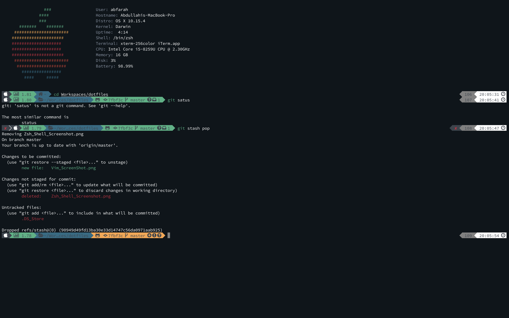
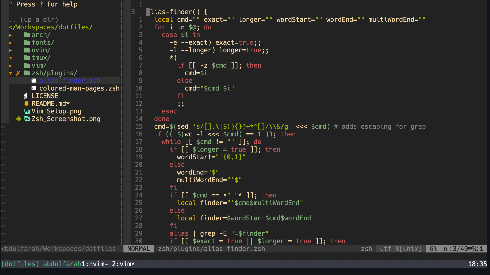
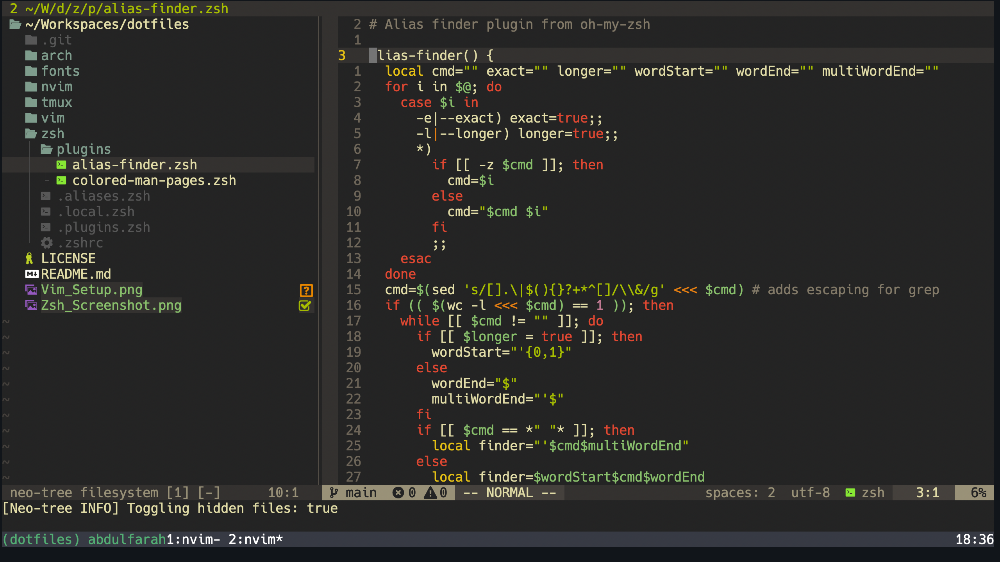
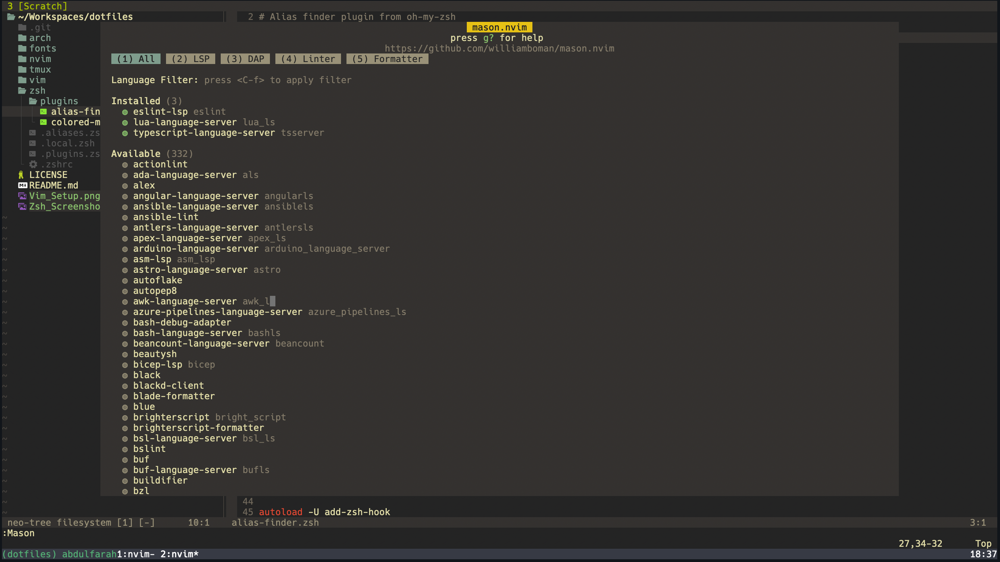

# Dotfiles
My personal nvim, vim, zsh, tmux, and Ghostty configuration.

# Zsh configuration - Mac
My zsh config files:
`~/.zshrc`, `~/.local.zsh`, `~/.aliases.zsh`, `~/.plugins.zsh`

### Requirements
1. Install [Homebrew](https://brew.sh/).
   If you run into permission issues:
   ```bash
   sudo chown -R $USER [path]
   # or
   sudo chown -R $USER:[group] [path]
   ```
2. Install the following packages:
   ```bash
   brew install zsh wget vim neovim nvm macchina zsh-autosuggestions zsh-syntax-highlighting fzf tmux yarn tree gnupg
   ```

### Set primary shell to zsh
1. Zsh is the default shell on macOS Catalina and later, so the steps below only apply to older versions of macOS.
2. Check which shell is being used: `echo $SHELL`. Skip to the next section if it's zsh.
3. Confirm where Homebrew zsh is installed: `which zsh`. Locations differ for Intel (`/usr/local/bin`) and Apple Silicon (`/opt/homebrew/bin`) Macs.
4. Add zsh to allowed shells:
   ```bash
   echo "$(which zsh)" | sudo tee -a /etc/shells
   ```
5. Change shell to the newest version of zsh:
   ```bash
   chsh -s "$(which zsh)"
   ```
6. Close and reopen your terminal and run `echo $0` to confirm you're running zsh.

### Ghostty setup
1. Install [Ghostty](https://ghostty.org/download) via Homebrew:
   ```bash
   brew install --cask ghostty
   ```
2. Install fonts via Homebrew (no manual downloads needed):
   ```bash
   brew install --cask font-meslo-for-powerlevel10k
   ```
   MesloLGS NF is the font recommended by powerlevel10k. Optional extras: `font-hack-nerd-font`, `font-sauce-code-pro-nerd-font` (replaces the old manually downloaded `SourceCodePro+Powerline+Awesome` font).
3. Confirm the font names Ghostty sees:
   ```bash
   ghostty +list-fonts | grep -i meslo
   ```
4. Edit the Ghostty config at `~/.config/ghostty/config` (open it from Ghostty with `Cmd + ,`):
   ```
   font-family = "MesloLGS NF"
   font-size = 14
   theme = Glacier
   ```
   To try other themes, list them with `ghostty +list-themes`.
5. Reload the config with `Cmd + Shift + ,`.

### SSH setup
1. Generate the SSH key (replace `your_email@example.com` with your email):
   ```bash
   ssh-keygen -t ed25519 -C "your_email@example.com" -f ~/.ssh/id_ed25519_github
   ```
2. Start the agent:
   ```bash
   eval "$(ssh-agent -s)"
   ```
3. Add the key to the agent and macOS Keychain:
   ```bash
   ssh-add --apple-use-keychain ~/.ssh/id_ed25519_github
   ```
4. Add a GitHub entry to `~/.ssh/config`:
   ```
   Host github.com
     HostName github.com
     User git
     AddKeysToAgent yes
     UseKeychain yes
     IdentityFile ~/.ssh/id_ed25519_github
     IdentitiesOnly yes
   ```
5. Copy the public key:
   ```bash
   pbcopy < ~/.ssh/id_ed25519_github.pub
   ```
6. Add it to GitHub: **Settings → SSH and GPG keys → New SSH key**, paste, and save.
7. Test the connection:
   ```bash
   ssh -T git@github.com
   ```

### iTerm2 setup (optional, previous terminal)
1. Install [iTerm2](https://www.iterm2.com/):
   ```bash
   brew install --cask iterm2
   ```
2. Download iTerm color schemes:
   - https://github.com/MartinSeeler/iterm2-material-design
   - https://github.com/mbadolato/iTerm2-Color-Schemes
3. Install fonts via Homebrew (same as the Ghostty step) and select `MesloLGS NF` in **Settings → Profiles → Text**:
   ```bash
   brew install --cask font-meslo-for-powerlevel10k
   ```

### Dotfiles
1. Copy dotfiles over from this repo:
   ```bash
   cp zsh/.zshrc ~/.zshrc
   cp zsh/.local.zsh ~/.local.zsh
   cp zsh/.aliases.zsh ~/.aliases.zsh
   cp zsh/.plugins.zsh ~/.plugins.zsh
   cp zsh/.p10k.zsh ~/.p10k.zsh
   cp vim/.vimrc ~/.vimrc
   cp tmux/.tmux.conf ~/.tmux.conf
   cp -r nvim ~/.config/nvim
   ```
2. Reload the zshrc file:
   ```bash
   source ~/.zshrc
   ```

### Configure powerlevel10k theme
1. Install powerlevel10k via Homebrew:
   ```bash
   brew install powerlevel10k
   ```
   The `~/.zshrc` copied from this repo already sources the theme. If you have an old `~/powerlevel10k` git clone, delete it.
2. Restart the terminal or run `exec zsh`.
3. Make sure the MesloLGS NF font is installed and set in Ghostty (see [Ghostty setup](#ghostty-setup)):
   ```bash
   brew install --cask font-meslo-for-powerlevel10k
   ```
4. If `~/.p10k.zsh` was copied over from the dotfiles, the prompt is already configured. To reconfigure, run `p10k configure`.
5. Update with `brew upgrade powerlevel10k`.

#### Zsh plugins
1. Syntax highlighting plugin
2. Auto suggestion plugin
3. Confirm both plugins are being sourced in `~/.plugins.zsh`.

### Configure NVM & install Node
1. `mkdir ~/.nvm`
2. Uncomment the nvm export in `~/.local.zsh`.
3. `nvm install node`

### Install Java using SDKMAN!
1. Install SDKMAN! and Java:
   ```bash
   curl -s "https://get.sdkman.io" | zsh
   source "$HOME/.sdkman/bin/sdkman-init.sh"
   sdk install java
   ```
2. Confirm the install:
   ```bash
   sdk version
   java -version
   ```

#### Screenshot of zsh setup


# Vim configuration
I moved over to Neovim as my primary editor.
My Vim config uses vim-plug to manage plugins.

### Requirements
Install on Mac using [Homebrew](https://brew.sh/):
```bash
brew install vim
```

## vim-plug installation and configuration
1. Install vim-plug:
   ```bash
   curl -fLo ~/.vim/autoload/plug.vim --create-dirs \
     https://raw.githubusercontent.com/junegunn/vim-plug/master/plug.vim
   ```
2. Make sure `~/.vimrc` is copied over from the dotfiles. Open Vim and run `:PlugInstall` to install plugins.
3. If you get a yarn install error, run the Vim command `:call coc#util#install()`.
4. Close and reopen Vim.

#### Screenshot of vim setup


# Neovim configuration
My primary editor. Previously used Vim.

### Requirements
Install on Mac using [Homebrew](https://brew.sh/):
```bash
brew install neovim
```

Plugins are managed with [lazy.nvim](https://github.com/folke/lazy.nvim), which requires `git` and a [Nerd Font](#ghostty-setup) for icons.

## Configure
1. Make sure the nvim Lua config files are in `~/.config/nvim/`:
   ```bash
   mkdir -p ~/.config
   cp -r nvim ~/.config/nvim
   ```
2. Open Neovim: `nvim`.
   On first launch, lazy.nvim bootstraps itself and installs all plugins automatically. Restart Neovim once it finishes.

## After install
1. Manage plugins with `:Lazy`
   - `:Lazy sync` installs missing plugins, updates, and removes unused ones
   - `:Lazy restore` installs the exact versions pinned in `lazy-lock.json`
2. Commit `~/.config/nvim/lazy-lock.json` back to this repo after updating so every machine uses the same plugin versions.
3. Keyboard shortcuts: `<leader>km`

#### Screenshots of nvim setup


